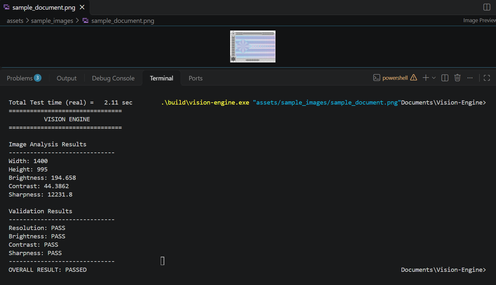
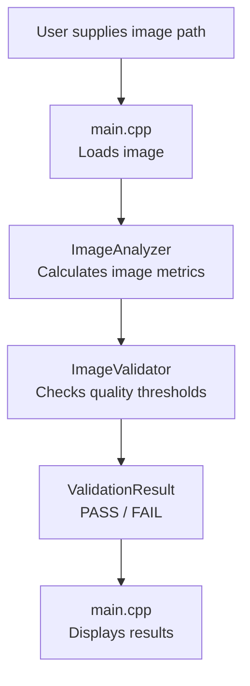

# Vision Engine

**A C++ image quality analysis and validation application built with OpenCV.**

Vision Engine is a C++17 application designed to analyse digital images and evaluate their quality against configurable validation criteria.

The project demonstrates object-oriented programming, image processing, software architecture, exception handling, automated testing and CMake-based build management.

## Features

- **Image analysis:** Measures image resolution, average brightness, contrast and sharpness.
- **Image validation:** Evaluates image measurements against defined quality thresholds.
- **Command-line interface:** Allows users to supply image paths directly when launching the application.
- **Error handling:** Handles missing image paths, unreadable images and analysis errors.
- **Automated testing:** Uses GoogleTest for unit and command-line integration tests.

## Technology Stack

| Technology | Purpose |
|---|---|
| C++17 | Core application development |
| OpenCV | Image processing and analysis |
| CMake | Build configuration and dependency management |
| GoogleTest | Automated testing |
| Git / GitHub | Version control and project hosting |

## Project Architecture

The application follows a modular structure with separate responsibilities.

```text
Vision-Engine/
│
├── assets/
│   └── sample_images/
│       └── sample_document.png
│
├── include/
│   ├── image_analyzer.h
│   └── image_validator.h
│
├── src/
│   ├── main.cpp
│   ├── image_analyzer.cpp
│   └── image_validator.cpp
│
├── tests/
│   ├── image_validator_tests.cpp
│   └── command_line_tests.cpp
│
├── CMakeLists.txt
└── README.md
```

### Core Components

**ImageAnalyzer**

Responsible for processing images and extracting quality measurements:

- Width and height
- Average brightness
- Contrast
- Sharpness

**ImageValidator**

Evaluates the measurements produced by ImageAnalyzer against predefined quality thresholds and returns individual validation results.

**Main Application**

Handles command-line arguments, image loading, application execution, error handling and displaying results.

## Image Validation Criteria

The current implementation uses the following initial thresholds:

| Measurement | Validation Requirement |
|---|---|
| Resolution | Minimum 800 × 600 pixels |
| Brightness | Between 50 and 220 |
| Contrast | Minimum 20 |
| Sharpness | Minimum 1000 |

These are configurable demonstration thresholds rather than industry-standard image quality specifications.

**Note:** Vision Engine performs general image quality analysis. It does not perform banknote authentication, counterfeit detection or financial document verification.

## Prerequisites

To build the application, you will need:

- A C++17-compatible compiler
- CMake 3.20 or newer
- OpenCV
- Git
- An internet connection for the initial GoogleTest download through CMake FetchContent

## Building the Project

Clone the repository:

```bash
git clone https://github.com/sbalus08-bit/Vision-Engine.git
cd Vision-Engine
```

Configure the project:

```bash
cmake -S . -B build
```

If CMake cannot automatically locate OpenCV, specify its installation directory:

```bash
cmake -S . -B build -DOpenCV_DIR="PATH_TO_OPENCV_CONFIG"
```

Build the application:

```bash
cmake --build build
```

## Running the Application

Supply an image path as a command-line argument:

```bash
./build/vision-engine assets/sample_images/sample_document.png
```

On Windows PowerShell:

```powershell
.\build\vision-engine.exe "assets/sample_images/sample_document.png"
```

The application displays the extracted image measurements and the individual validation results.

## Automated Testing

Vision Engine uses GoogleTest to test its core functionality.

The test suite includes:

- Valid image measurements
- Invalid resolution
- Invalid brightness
- Invalid contrast
- Invalid sharpness
- Boundary value testing
- Empty image handling
- Missing command-line arguments
- Invalid image paths
- Valid image input

Run the automated tests using:

```bash
ctest --test-dir build --output-on-failure
```

The initial development test suite contains **14 automated tests** covering unit and command-line integration scenarios.

## Project Objectives

This project was developed to strengthen practical experience in:

- C++ application development
- Object-oriented programming
- Modular software architecture
- Computer vision and image processing
- Exception handling
- Automated unit and integration testing
- CMake and dependency management
- Version control with Git

## Future Improvements

Potential future enhancements include:

- Configurable validation thresholds
- Additional image quality metrics
- Improved command-line options
- Expanded automated test coverage
- More comprehensive reporting

---

**Project:** Vision Engine  
**Language:** C++17  
**Status:** Active development


## Application Screenshot

The following screenshot demonstrates Vision Engine analysing a sample document and successfully completing all four image quality validation checks.




## Architecture

Vision Engine uses a modular design, separating image processing from image quality validation.




